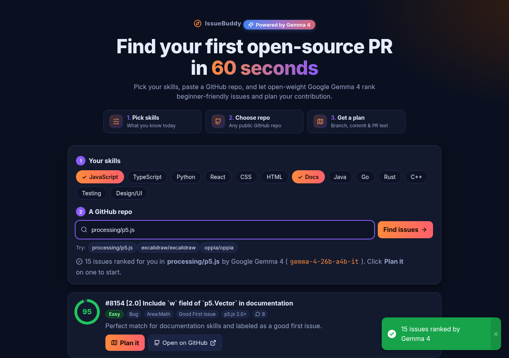
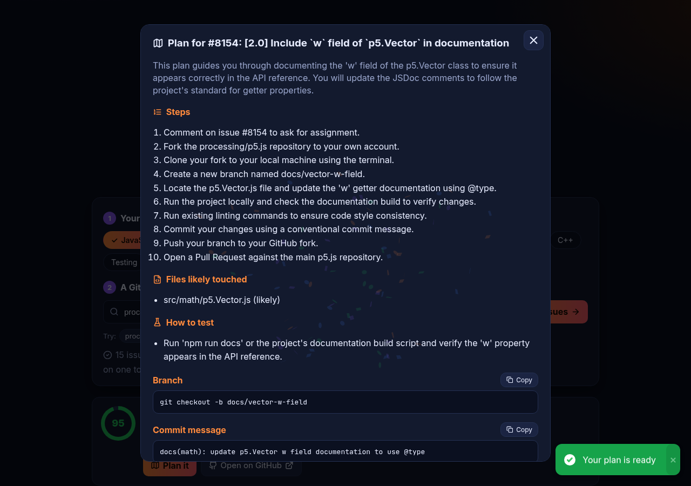
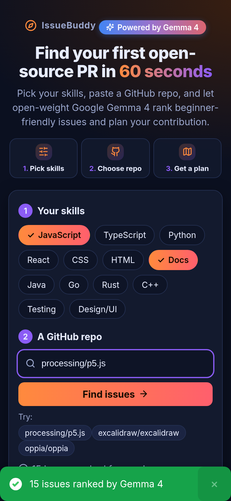

# 🧭 IssueBuddy: find your first PR in 60 seconds

**🔗 Live demo: [issuebuddy-hackday.vercel.app](https://issuebuddy-hackday.vercel.app)**

Hacktoberfest is here, but beginners spend hours searching for an issue they can actually solve.
**IssueBuddy** asks for your skills and a GitHub repo, pulls its beginner-friendly issues, uses **open-weight AI** to rank them by how well they fit *you*, and then writes a step-by-step contribution plan with a ready-to-paste commit message and PR description.

Built at **MLH Hacktoberfest Hack Day Prayagraj × WikiClub Tech UIT (Edition 2.0)**.





## ✨ Features
- **Skill picker**: JavaScript, TypeScript, Python, React, CSS, HTML, Docs, Java, Go, Rust, C++, Testing, Design/UI.
- **Any public repo**: paste `owner/repo` or a GitHub URL, or try a sample repo (p5.js, Excalidraw, Oppia, all of which have open `good first issue` labels).
- **Live issues** from the GitHub public REST API, fetched in the browser, covering the labels `good first issue`, `hacktoberfest`, `help wanted` and `documentation`. Assigned issues sort to the bottom, and there's a friendly message when you hit the rate limit.
- **AI ranking** (`/api/rank`): a 0 to 100 fit score, a difficulty (Easy/Medium/Hard) and a one-line reason for each issue.
- **Plan it** (`/api/plan`): steps (ask to be assigned → fork → branch → change → test → PR), the files likely touched, how to test, a branch name, the commit message, and the PR title and body, each with a Copy button.
- Responsive dark UI, skeleton loaders, and graceful errors (if the AI is unavailable, the issues still show unranked).

## 🧠 Open-weight AI: Powered by Google Gemma 4 (open-weight)
All AI ranking and planning runs on **Google Gemma 4**, Google's open-weight model family, through the [Gemini API](https://ai.google.dev/gemma/docs). It sends each request to **`gemma-4-31b-it`** and **`gemma-4-26b-a4b-it`** in parallel and uses whichever valid answer arrives first. Each model retries with a short backoff (25 s per call, ~50 s total), so it's Gemma end to end with no other provider. Gemma has no system role or JSON mode, so the instructions go in the user turn and the JSON is parsed robustly (code fences are stripped and the first `{...}` is extracted). The API key stays on the server (`GEMINI_API_KEY`) and never reaches the browser.

**Why Gemma 4:** its weights are open, so this whole project can be self-hosted (Ollama, llama.cpp, vLLM) with no closed model in the loop. It follows JSON instructions reliably, and it's free to use through the Gemini API.

## 🛠 Tech
Static `index.html` + `style.css` + `app.js` (no build step) · Vercel serverless functions in `api/` · Node 18+ `fetch` · **Google Gemma 4** via the Gemini API (`generateContent`) · GitHub REST API.

## 🤖 Use it as an Agent Skill / CLI
IssueBuddy also ships as a zero-dependency **CLI** and an **Agent Skill** ([Agent Skills open standard](https://agentskills.io)), so AI coding agents can find and plan a contribution for you.

```bash
export GEMINI_API_KEY=your_key            # optional: GITHUB_TOKEN for higher GitHub limits
node cli.js processing/p5.js --level beginner --skills JavaScript,Docs   # ranked issues
node cli.js processing/p5.js --plan 8154                                 # step-by-step plan
node cli.js processing/p5.js --json                                      # machine-readable for agents
```
The skill is in [`skills/issuebuddy/SKILL.md`](skills/issuebuddy/SKILL.md). Copy that folder into your agent's skills directory (for example `~/.claude/skills/` or `.github/skills/`), and the agent will run the CLI whenever you ask *"what can I contribute to owner/repo?"*. The web app, the CLI and the skill all share the same logic in `lib/issuebuddy.js` and the same Gemma 4 helper in `api/_gemma.js`.

## 🚀 Run locally
```bash
git clone <this repo> && cd issuebuddy
GEMINI_API_KEY=your_key node server.js   # http://localhost:3000  (free key: https://aistudio.google.com/apikey)
```
`server.js` serves the static files and the `api/*.js` functions the same way Vercel does. No dependencies are needed.

**Deploy:** import the repo on Vercel, add the env var `GEMINI_API_KEY` (and optionally `GEMMA_MODEL` to override the primary Gemma model), then deploy. The framework preset is "Other".

## 👥 Team
- **Abhi** ([@THE-AB-mark](https://github.com/THE-AB-mark)), team leader
- **Kriti Kumari**

## 🤝 Contributing
We're a Hacktoberfest project too! See [CONTRIBUTING.md](CONTRIBUTING.md) for good first issues.

## 📄 License
[MIT](LICENSE)
